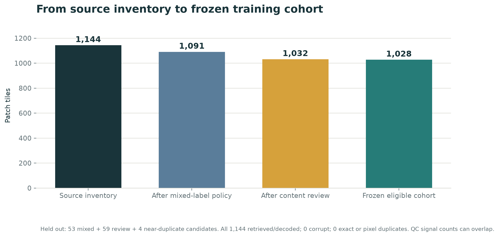
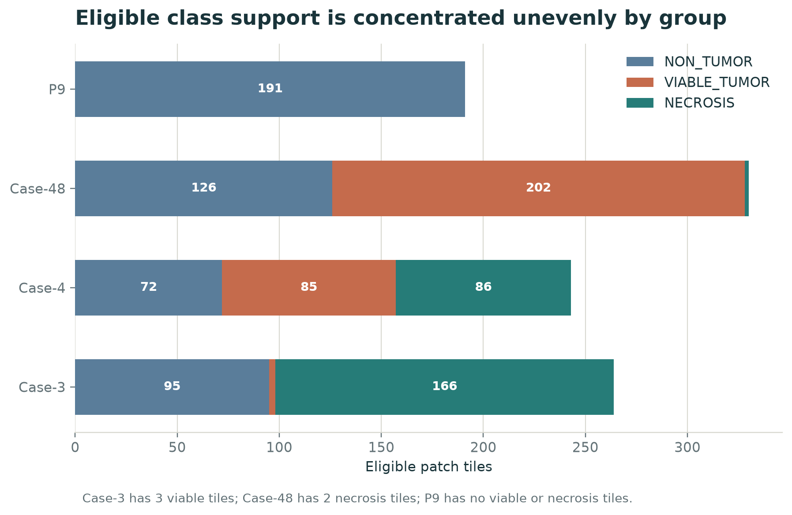
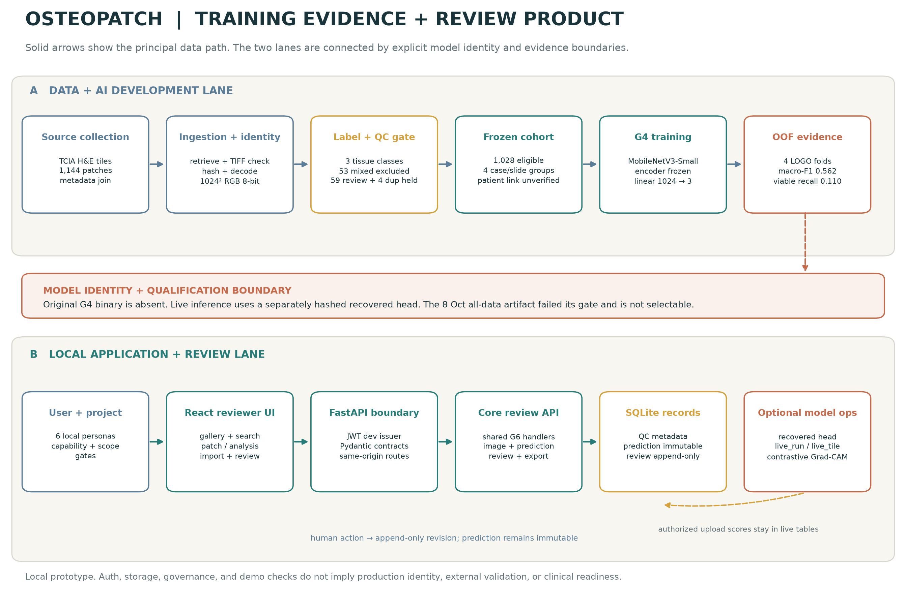
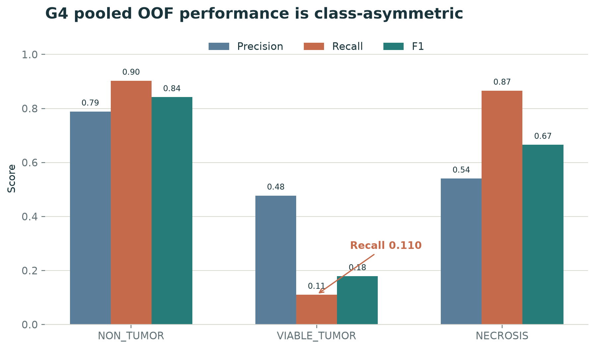
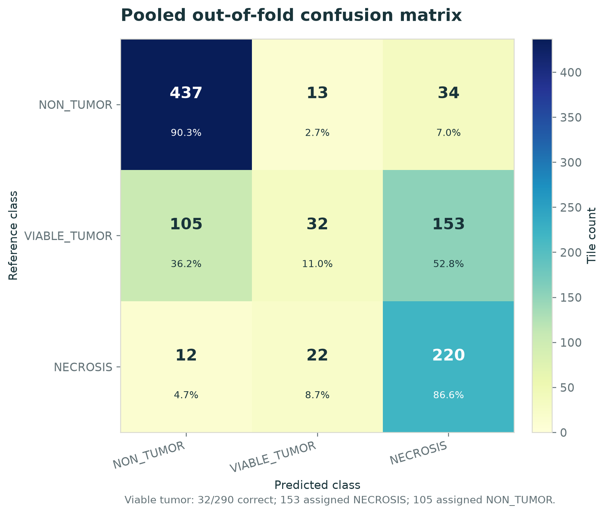
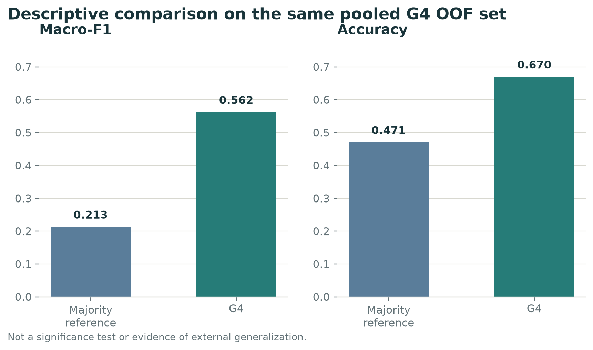
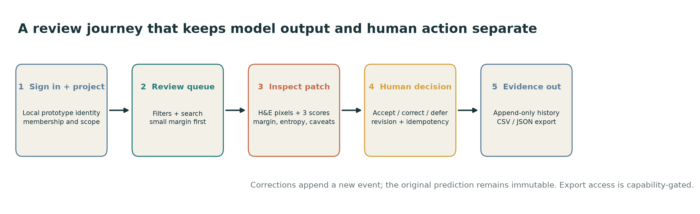

# OsteoPatch: Design, Implementation, and Exploratory Evaluation of an AI-Assisted Osteosarcoma Histology Review System

**Thesis-style engineering and medical research report**

Evidence snapshot: 8 October 2026

Project: OsteoPatch educational and research prototype

> **Scope statement.** This report describes a patch-classification and human-review prototype. It is not a clinical validation study, clinical decision-support recommendation, diagnostic report, or treatment-response analysis. OsteoPatch is not for diagnosis, ruling out disease, treatment decisions, prognosis, or clinical reporting. Its scores are uncalibrated model scores, not disease probabilities.

## Abstract

**Background.** Osteosarcoma is an aggressive primary bone cancer that mainly affects adolescents and young adults. Histologic response after preoperative chemotherapy is associated with outcomes, while reviewing heterogeneous resection tissue across slides is visually demanding. Prior computational studies show technical feasibility, but use different cohorts, analysis units, and validation designs.

**Objective.** To document OsteoPatch’s medical rationale, data curation, model development, software design, evaluation, and limitations.

**Methods.** The TCIA collection supplied 1,144 H&E patch tiles. Labels were normalized to three tissue classes; mixed viable/necrotic tiles remained review-only. After technical QC and exclusions, 1,028 tiles entered evaluation. An ImageNet-pretrained MobileNetV3-Small with frozen encoder and trainable three-class head was assessed by four case/slide-token leave-one-group-out folds, producing one out-of-fold score per tile. The application pairs a React/TypeScript review interface with Python/FastAPI services and SQLite persistence.

**Results.** The frozen G4 model achieved pooled out-of-fold macro-F1 0.5623, balanced accuracy 0.6265, accuracy 0.6702, log loss 1.1947, and Brier score 0.4961. Recall was 0.1103 for viable tumor (32/290), 0.9029 for non-tumor, and 0.8661 for necrosis. A later fine-tuning experiment did not improve the baseline. The 8 October three-seed campaign failed its qualification gates; its artifact was not made selectable. Software checks support implementation behavior, not medical performance.

**Conclusion.** The main contribution is an evidence-aware research workflow with uncertainty ordering, immutable predictions, append-only human decisions, and explicit model identity. The current classifier is not reliable for clinical use, particularly for viable-tumor detection. Patient independence is unverified, only four groups were evaluated, and external validation is absent. Future work requires patient-linked multi-institutional data and clinically meaningful validation.

**Keywords:** osteosarcoma; digital pathology; H&E; patch classification; MobileNetV3-Small; group-held-out evaluation; human-in-the-loop review; FastAPI; React; model provenance

## Contents

1. Introduction and research problem
2. Medical background and motivation
3. Related literature
4. Product definition and intended use
5. Data provenance and curation
6. AI development and evaluation methods
7. Model results
8. Software engineering and system behavior
9. Verification and benchmarking
10. Discussion
11. Limitations, ethics, and governance
12. Future work
13. Conclusion
Appendices A–F. Technical detail, statistics, verification, and reproducibility

## 1. Introduction and research problem

### 1.1 The problem

Digital pathology turns glass-slide microscopy into large image collections. Osteosarcoma resection material can contain viable tumor, treatment-related necrosis, non-tumor tissue, and artifacts within the same case. The reviewer may need to move between many tiles and slides while keeping track of what has been assessed. The practical product hypothesis is that a review interface can help a human find ambiguous or review-worthy patches sooner, preserve decisions, and make the evidence behind each score visible.

The project does **not** contain a time-and-motion study showing that pathologists spend a specified number of minutes per case, nor a user study demonstrating reduced workload or improved agreement. The pain point is therefore a workflow rationale, not a measured efficiency claim. OsteoPatch has been built to make an exploratory workflow concrete and testable: browse patches, rank by score ambiguity, inspect the image and context, record a human action, and export a traceable review.

### 1.2 Why osteosarcoma was selected

Osteosarcoma is a useful and medically important research setting for four reasons:

1. **Clinical relevance of histologic response.** Histologic response after preoperative chemotherapy is associated with outcomes in osteosarcoma. In a retrospective single-institution cohort of 881 non-metastatic extremity cases, Bacci and colleagues reported 5-year disease-free survival of 67.9% in good responders versus 51.3% in poor responders, and overall survival of 78.4% versus 63.7%, respectively [2].
2. **A tissue distinction that is visually and biologically meaningful.** Viable tumor and necrotic tumor are distinct tissue categories and are relevant to post-treatment response assessment. Separating these categories at patch level is challenging, making the problem suitable for research on model review and uncertainty handling.
3. **A public, documented data resource.** TCIA provides the Osteosarcoma-Tumor-Assessment collection with image tiles and a metadata table; its collection page reports 1,144 images and requires dataset citation and license attribution [4].
4. **A focused prototype scope.** A small, public patch cohort supports an end-to-end engineering demonstration—from label provenance and QC through training, API, review interface, and export—without implying that a rare disease dataset of four groups can support a clinical model.

The rarity of the disease makes data limitations especially important. NCI’s PDQ describes osteosarcoma as occurring predominantly in adolescents and young adults, with an estimated incidence of 5.4 cases per million per year among people aged 0–19 years [1]. Rarity strengthens the case for collaborative data research; it does not make this dataset representative or the present model clinically reliable.

### 1.3 Research aim and questions

**Aim:** describe and evaluate the creation of an educational software prototype for uncertainty-aware review of osteosarcoma H&E patches, including its frozen baseline classifier, data pipeline, and software controls.

**Research questions**

- **RQ1 — Medical/product:** What narrow review task can an educational patch-review application support without claiming diagnosis or treatment-response assessment?
- **RQ2 — Data and ML:** What results does a small, frozen-encoder, three-class patch model obtain when all tiles from a recovered case/slide group are held out together?
- **RQ3 — Engineering:** How can model scores, provenance, human review actions, and live-import behavior be represented without overwriting one another?
- **RQ4 — Evidence:** Which conclusions are supported by software tests, and which require clinical or external model validation that has not been performed?

### 1.4 Contributions

This report contributes a traceable account of:

- Dataset mapping and a complete recorded technical-ingestion/QC funnel for 1,144 tiles.
- A four-group leave-one-group-out baseline with pooled out-of-fold metrics, class-wise errors, and explicit sparse-support limitations.
- A product architecture that separates source/QC metadata, immutable model predictions, append-only review events, and live-inference results.
- A human-centered workflow that orders patches using deterministic ambiguity signals while avoiding the claim that those signals are calibrated error probabilities.
- A clear separation between engineering verification and clinical/model validation.

## 2. Medical background and motivation

### 2.1 Disease and treatment context

Osteosarcoma is a primary malignant bone tumor that predominantly affects adolescents and young adults. Treatment commonly combines systemic therapy and surgery, with the resection specimen providing histologic evidence of treatment effect. The clinical relevance of residual viable tumor and necrosis is supported by retrospective outcome studies and reflected in contemporary disease summaries [1, 2].

Histologic response is not the same as a model’s patch label. A case-level response assessment aggregates observations across an entire resection specimen and may use a percentage or grade based on viable tumor versus treatment effect. OsteoPatch’s classifier operates on individual image patches and outputs one of three patch classes. It does not compute a validated case-level necrosis ratio, apply a clinical cutoff, predict survival, or recommend therapy.

### 2.2 Why the visual task is difficult

Histologic appearance varies within a slide and between slides. A patch can include mixed tissue, low-information fields, stain variation, preparation artifacts, or a boundary between morphologies. A label assigned to a patch compresses a rich image into one predominant category. The project’s 53 mixed viable/non-viable labels demonstrate that some source examples are not naturally represented by a single exclusive class.

There is also a statistical problem: tiles from the same patient or slide can share acquisition conditions, tissue appearance, and neighboring structures. If closely related tiles appear in both training and test data, a model may benefit from sample-specific similarity rather than learning features that transfer to a new case. This motivates grouping all tiles with a case/slide token into the same outer fold. Because project metadata does not contain a verified token-to-patient mapping, the evaluation is correctly described as **case/slide-group-held-out**, not patient-independent.

### 2.3 The clinical importance is motivation, not intended use

The literature establishes a rationale for studying tissue response in osteosarcoma. It does not establish that this application measures response. The current product is an educational/research tool for patch review. It must not be used to grade response, calculate a patient’s necrosis percentage, stratify prognosis, rule out viable tumor, or inform treatment.

This distinction is central to responsible product design: the medical need explains why the tissue classes are worth studying; the implemented application remains a patch-level review prototype with weak viable-tumor sensitivity.

## 3. Related literature

### 3.1 Histologic response and outcomes

Bacci et al. studied 881 patients with non-metastatic extremity osteosarcoma treated with neoadjuvant chemotherapy and surgery at one institution. Good and poor histologic responders had different 5-year disease-free and overall survival estimates, with both reported differences statistically significant at P < 0.0001 [2]. The authors also report that prognostic value varied by histologic subtype. These findings motivate careful response research; they cannot be transferred to OsteoPatch, whose dataset lacks patient-level outcomes and whose model predicts patch labels rather than prognosis.

### 3.2 Osteosarcoma tile-classification literature

Arunachalam et al. described a computational pipeline for viable tumor, necrotic tumor, and non-tumor assessment from osteosarcoma histology [3]. The paper describes 50 archival cases, selection of 40 slides, 1,144 1024×1024 tiles, and 56,929 overlapping 128×128 patches for deep-learning. It reports 93.3% patch-level accuracy for its deep learner, 91.2% tile accuracy, and a three-class VUS of 0.959 in its hierarchical evaluation. The study’s models and evaluation units differ from OsteoPatch’s frozen G4 baseline.

The paper’s 80/20 hierarchical ROC analysis randomly divided 1,144 tiles into 914 training and 230 testing tiles [3]. This tile-random split is not directly comparable to the present case/slide-group-held-out estimate. In addition, the reported patch-level accuracy is measured on generated overlapping subpatches, while the OsteoPatch headline metrics use one predicted class per eligible 1024×1024 tile. Accuracy, VUS, split unit, model architecture, and label protocol are not interchangeable. The literature value is contextual evidence, not a benchmark that the present model has beaten or matched.

### 3.3 Whole-slide and multi-magnification response assessment

Ho et al. evaluated a Deep Multi-Magnification Network using 103 osteosarcoma cases and 3,134 whole-slide images. Their system performs pixel-level tissue segmentation and aggregates viable and necrotic tumor pixels to estimate case-level necrosis ratios. The authors report correlation with expert pathology-report measurements and survival stratification results, including P = 2.4×10⁻⁶ for overall survival at an 80% cutoff and P = 0.016 for progression-free survival at a 60% cutoff in that study’s analysis [5].

This is a larger and different research task. Ho et al. use WSI-level segmentation, multiple magnifications, case-level aggregation, outcomes, and a much larger cohort. OsteoPatch currently performs patch classification and human review. Its live slide import creates a fixed grid of tiles at one level and does not reproduce the published multi-magnification segmentation method.

### 3.4 Literature synthesis

The literature supports the following conclusions:

- Histologic treatment response is medically meaningful in osteosarcoma [1, 2].
- Computational analysis of osteosarcoma tissue is a viable research direction [3, 5].
- Earlier high tile-level metrics must be interpreted in light of their unit of analysis and split strategy [3].
- A patch classifier is only one component of a potential whole-slide response workflow; segmentation, case-level aggregation, clinical covariates, and outcome validation require separate evidence [5].

The distinctive contribution of OsteoPatch is not a new clinical algorithm. It is the engineering of an evidence-labeled review workflow around a modest patch classifier, with explicit separation of evaluation records, model artifacts, human actions, and live inference.

## 4. Product definition and intended use

### 4.1 Intended use

OsteoPatch is an **educational and research patch-review prototype**. It enables a permitted user to inspect H&E patches, see three uncalibrated class scores and review-priority signals, optionally view a qualified contrastive attribution, record a review action, and export review records.

It is not intended to:

- Diagnose or exclude osteosarcoma or any other disease.
- Determine patient-level chemotherapy response or percent tumor necrosis.
- Predict prognosis, relapse, survival, or treatment response.
- Replace or direct a pathologist’s examination.
- Support clinical reporting or treatment decisions.
- Process identifiable patient material in its current demo configuration.

### 4.2 Users and roles

The prototype models six project personas: student, reviewer, pathologist, admin, ML engineer, and auditor. Current code implements capability-gated routes and project membership checks for key operations. These are prototype roles and a local development identity mode, not production identity assurance or a compliance certification.

| Persona | Typical activity in the prototype |
|---|---|
| Student | Read permitted project patches and learn from the review surface |
| Reviewer | Inspect patches and submit accept, correct, or defer actions |
| Pathologist | Review or adjudicate tissue-category disagreements within the prototype workflow |
| Project admin | Create projects, manage membership, and scope data |
| ML engineer | Inspect model metadata and governance surfaces |
| Auditor | Read audit evidence and review history where authorized |

### 4.3 User-facing capabilities

The current product surfaces cover:

- Project selection and scope-aware image gallery.
- An uncertainty-first review queue with filters and deterministic ordering.
- Patch detail with the original H&E pixels, class scores, score margin, entropy, and model caveats.
- Contrastive Grad-CAM attribution when the separate recovered model and optional model dependencies are available.
- ACCEPT, CORRECT, and DEFER actions with revision and idempotency handling.
- Review-history and CSV/JSON export paths.
- Patch import and slide-file import for live research inference.
- Fixed-grid tile results with individual score and uncertainty signals.
- Project and capability boundaries; an audit chain; and model registry/governance endpoints.

The interface deliberately surfaces “not determined” when a score margin is too small to assert a class, instead of presenting a confident-looking class label. Thresholds are product review cues, not clinically validated operating points.

### 4.4 Product boundary by evidence state

| Area | Implemented or recorded | Boundary |
|---|---|---|
| Patch gallery/review | Source code, browser evidence, API checks | Educational/research review only |
| G4 evaluation | Frozen 1,028-tile pooled OOF record | Four case/slide groups; patient mapping unverified |
| Live upload/inference | Local authenticated prototype and 43 recorded checks | Recovered head, one-level fixed grid, no clinical validation |
| Project roles/scope | Local role and project checks | Development identity is not production SSO |
| Attribution | Contrastive Grad-CAM over recovered head | Model-behavior visualization, not causal explanation or segmentation |
| Cloud deployment | Historical AWS slice and deployment contracts documented | Current source/deployed revision not freshly verified; deployment remains disabled |
| Market evidence | No validated market sizing or named marketing team in the project | Any commercialization organization is proposed only |

## 5. Data provenance and curation

### 5.1 Source and data unit

The project’s source collection is TCIA’s Osteosarcoma-Tumor-Assessment dataset, DOI 10.7937/tcia.2019.bvhjhdas [4]. The project’s audited metadata table contains 1,144 records. The corresponding local ingestion evidence records 1,144 image objects, all 1024×1024 TIFF little-endian images with RGB 8-bit data, at a published approximate magnification of 10×. The unit used for G4 is one pre-extracted patch tile, not one patient, case, whole-slide image, or independently sampled biological specimen.

The source collection metadata and image objects are distinct from the historical 50-image public demo subset used in some older application evidence. The frozen model result uses 1,028 eligible images. These denominators must not be mixed.

### 5.2 Label normalization

The raw source labels were preserved and mapped under a ratified label policy:

| Source label | Count | Canonical model class or review state | Training use |
|---|---:|---|---|
| Non-Tumor | 536 | NON_TUMOR | Eligible only when QC passes |
| Viable | 292 | VIABLE_TUMOR | Eligible only when QC passes |
| Non-Viable-Tumor | 263 | NECROSIS | Eligible only when QC passes |
| viable: non-viable | 53 | MIXED_VIABLE_NECROTIC review state | Always excluded from three-class training |

The mixed label is not a fourth learned class. It remains represented in the manifest as a non-trainable review state so it is not silently recoded as viable or necrotic. The 53 mixed tiles explain the difference between the project’s 292 direct Viable labels and the 345 viable labels in the published collection description [3, 4].

### 5.3 Technical cleaning and QC

The full-collection ingestion/QC report records the following sequence (project evidence: aidlc-docs/inception/full-image-qc/full-image-qc-report.md):

1. **Manifest reconciliation.** All 1,144 manifest entries mapped to one image object; no duplicate manifest IDs, duplicate PathDB IDs, duplicate URLs, or unexplained extra local files were recorded.
2. **Retrieval check.** 1,144/1,144 images were retrieved; zero persistent retrieval failures remained after retrying two transient Windows rename-lock interruptions.
3. **File integrity and decoding.** File signatures were checked as TIFF little-endian; all 1,144 images decoded with truncated-image loading disabled. No decode failures or corrupt files were recorded.
4. **Format consistency.** All images were 1024×1024, RGB, 8-bit TIFF. The frozen preprocessing contract therefore applied without exceptions.
5. **Exact and pixel duplicate checks.** The report found zero byte-identical groups and zero decoded-RGB pixel-identical groups.
6. **Perceptual screen.** A pHash/dHash screen produced three pairs at the candidate threshold. Pixel confirmation found none equivalent under the project’s MAD criterion. A cross-group visually similar pair had pixel MAD 18.844/255 and was recorded as distinct; confirmed blocking cross-group duplicates were zero.
7. **Content review flags.** Non-semantic signals included 23 near-blank, 59 low-information, 8 very-bright, and 1 low-variance flags. These are image-quality signals, not pathology diagnoses; flags can overlap and were not summed into a unique image count.
8. **Eligibility freeze.** 59 content-REVIEW rows and 4 near-duplicate-candidate rows remained held for human review. With the 53 mixed tiles, 116 records were excluded from the G4 training manifest.

The resulting frozen eligible cohort was 1,028 tiles: 484 NON_TUMOR, 290 VIABLE_TUMOR, and 254 NECROSIS. A PASS QC state means the pixel-level pipeline allowed use under the training contract. It does not mean the image has undergone new clinical review, that the labels are error-free, or that samples are patient-independent.

**Figure 1.** Data-cleaning funnel from the full image inventory to the frozen G4 training cohort. Mixed-label, content-review, and near-duplicate exclusions are retained in the source manifest and excluded from model fitting.

### 5.4 Group reconstruction and split unit

No dedicated patient, case, slide, or group column was present in the audited CSV. The project reconstructed four non-overlapping group tokens from image names and PathDB paths: Case-3, Case-4, Case-48 (containing the P5 sub-token), and P9. Project evidence documents that PathDB subjectId is a per-patch identifier, not a biological patient identifier. The four group tokens are consistent with four published selected patients, but TCIA metadata reviewed by the project did not provide an explicit token-to-patient crosswalk.

Therefore:

- All G4 splits are described as **case/slide-token grouped**.
- Patient-level independence is **unverified**.
- No random tile split is used for G4.
- The source’s folder labels Training_Set_1 and Training_Set_2 are not treated as a validated train/test split.

The support table below shows why a standard three-way train/validation/test split is not credible in this cohort: P9 contains only NON_TUMOR in the eligible set; Case-3 contains only three viable-tumor tiles; Case-48 contains only two necrosis tiles.

**Figure 2.** Eligible class support in the four case/slide-token groups. The unequal support is material to the interpretation of held-out results.

## 6. AI development and evaluation methods

### 6.1 Prediction task

The model maps one 1024×1024 H&E patch tile to a three-element score vector in fixed order:

1. NON_TUMOR
2. VIABLE_TUMOR
3. NECROSIS

The predicted patch class is the score argmax, subject to product-level indeterminate handling when the top-two margin is small. Scores are not calibrated probabilities. They do not represent disease probability, patient risk, a validated confidence interval, or treatment response.

### 6.2 Model architecture

G4 uses torchvision MobileNetV3-Small initialized from ImageNet weights IMAGENET1K_V1. The pretrained encoder is frozen; all BatchNorm modules remain in evaluation mode. The original classification head is replaced with a linear layer from 1,024 embedding features to three class logits. This gives 3,075 trainable parameters in the classifier head. The pretrained feature extractor remains fixed.

This design was selected as a small, reproducible transfer-learning baseline under a limited cohort and CPU-only environment. Its advantage is constrained trainable capacity and manageable runtime. Its trade-off is that the feature encoder was trained on ImageNet, not osteosarcoma histology, and the baseline has not learned pathology-specific low-level features through encoder fine-tuning.

### 6.3 Preprocessing and augmentation

| Stage | Contract |
|---|---|
| Input | RGB 8-bit 1024×1024 TIFF |
| Resize | 384×384, bilinear interpolation, antialias enabled |
| Crop | None; full-field image is retained |
| Normalize | ImageNet mean [0.485, 0.456, 0.406], standard deviation [0.229, 0.224, 0.225] |
| Training-only augmentation | Horizontal flip, vertical flip, and rotations by multiples of 90 degrees |
| Evaluation transformation | Identity orientation, same resize and normalization |

The allowed flips and right-angle rotations form the eight-view dihedral set D4. Because the encoder was frozen, G4 precomputed the eight transformed embeddings for each eligible training tile and sampled a D4 view per image per epoch when fitting the head. This is mathematically equivalent to applying those transforms to the pixels and then passing them through the fixed encoder, while avoiding repeated CPU encoder computation. Evaluation uses the identity view.

### 6.4 Optimization recipe

| Parameter | G4 baseline value |
|---|---|
| Optimizer | AdamW |
| Learning rate | 1×10⁻³ |
| Weight decay | 1×10⁻⁴ |
| Batch size | 16 |
| Maximum epochs | 10 |
| Random seed | 42 |
| Loss | Cross-entropy with inverse-frequency training-fold-only class weights normalized to mean 1 |
| Early stopping | None; hyperparameters were fixed before outer-fold evaluation |
| Compute | CPU; CUDA unavailable in the recorded environment |
| Probability calibration | None |

No outer held-out group was used for hyperparameter tuning. There was no independent validation group for calibration or early stopping. The final all-data head was fit for prototype use after OOF evaluation; its training accuracy is not treated as model performance.

### 6.5 Split and evaluation design

G4 used four-fold leave-one-group-out (LOGO) evaluation:

1. Select one of the four case/slide tokens as the outer held-out group.
2. Train the head using only eligible tiles from the other three groups.
3. Score every eligible tile in the held-out group exactly once.
4. Repeat for each group.
5. Pool the out-of-fold scores across all 1,028 tiles for summary metrics.

The protocol prevents the most direct leakage in which tiles from one recovered group appear in both the training and test partition. It does not establish patient-level separation because group identity is inferred from filenames and lacks an explicit patient crosswalk. It also provides only four outer units, and the fold support is highly unequal. The P9 held-out fold contains one class, so viable and necrosis metrics are undefined for that fold. The pooled estimate is therefore exploratory and cannot support a broad generalization claim.

### 6.6 Statistical metrics

- **Macro-F1:** arithmetic mean of class-wise F1 scores, assigning equal weight to each class.
- **Balanced accuracy:** mean per-class recall over the three classes.
- **Accuracy:** fraction of all eligible tiles assigned the correct argmax class; secondary because it weights the larger class more.
- **Precision and recall:** class-specific positive predictive value and sensitivity at the patch-label level.
- **Log loss:** penalizes incorrect and overconfident score assignments; lower is better.
- **Multiclass Brier score:** score-vector error summary; lower is better. The score vectors remain uncalibrated.

No confidence intervals or hypothesis tests were produced for the four-group baseline. Tile-level observations are correlated within biological cases and slides; treating 1,028 tiles as 1,028 independent patients would produce misleading precision. No patient-cluster bootstrap was performed. ROC-AUC and VUS are not reported for the project baseline.

### 6.7 Reproducibility and artifact identity

The G4 run records environment versions, configuration, manifest hash, fold checkpoint hashes, pooled out-of-fold predictions, confusion matrix, per-fold metrics, and a final bundle hash. The original G4 binary is absent from the current project runtime, although its expected hash and immutable evaluation artifacts are recorded.

The live app’s recovered head, g4-behavioral-recovery-r1, has a different SHA-256 and is explicitly not the original G4 bundle. Behavioral agreement with surviving prediction rows does not establish identical weights, behavior on new data, generalization, or evaluation validity. The application records this distinction in attribution/live inference metadata. The report does not relabel the recovered head as the original G4 model.

**Figure 3.** Integrated evidence and product architecture. The upper lane shows source curation and group-held-out model evaluation; the lower lane shows the review application and its separate persistence paths. The G4 evaluation artifact, recovered live head, review events, and live-run outputs remain distinct.

## 7. Model results

### 7.1 Frozen G4 pooled out-of-fold results

| Metric | G4 value | Interpretation |
|---|---:|---|
| Eligible out-of-fold tiles | 1,028 | Each tile scored once by a model that held out its case/slide group |
| Macro-F1 | 0.562311 | Equal-weight average of three class F1 values |
| Balanced accuracy | 0.626460 | Mean class recall |
| Accuracy, secondary | 0.670233 | Overall correct patch labels |
| Log loss | 1.194723 | Uncalibrated score loss; lower is better |
| Multiclass Brier | 0.496084 | Uncalibrated score-vector error; lower is better |

The result is not uniformly strong across classes. Non-tumor recall is high, necrosis recall is also high, and viable-tumor recall is very low. A single accuracy value would conceal this failure mode.

**Figure 4.** Class-wise metrics from the frozen G4 pooled out-of-fold predictions. The viable-tumor recall is the main sensitivity limitation.

### 7.2 Class-wise performance and confusion matrix

| True class | Support | Precision | Recall | F1 |
|---|---:|---:|---:|---:|
| NON_TUMOR | 484 | 0.788809 | 0.902893 | 0.842004 |
| VIABLE_TUMOR | 290 | 0.477612 | **0.110345** | **0.179272** |
| NECROSIS | 254 | 0.540541 | 0.866142 | 0.665658 |

| True class ↓ / Predicted class → | NON_TUMOR | VIABLE_TUMOR | NECROSIS |
|---|---:|---:|---:|
| NON_TUMOR | 437 | 13 | 34 |
| VIABLE_TUMOR | 105 | **32** | **153** |
| NECROSIS | 12 | 22 | 220 |

Only 32 of 290 viable-tumor tiles were correctly classified as viable tumor. Another 153 were assigned NECROSIS and 105 NON_TUMOR. This makes the baseline unsuitable for any workflow that depends on reliably detecting viable tumor. A review-priority queue may help a human inspect ambiguous cases, but it does not repair a low-recall classifier or guarantee that errors are surfaced.

**Figure 5.** Confusion matrix for pooled G4 out-of-fold predictions. Rows are reference labels; columns are model labels.

### 7.3 Descriptive majority-class comparison

The project computed a per-fold majority-class reference using only each fold’s training groups. NON_TUMOR was the training majority in all four folds. Pooled reference accuracy was 0.470817 and macro-F1 was 0.213404. G4 scored 0.670233 accuracy and 0.562311 macro-F1 on the same pooled OOF tiles.

This is a useful check that the classifier learned more than a constant majority response on this dataset. The difference is descriptive: no uncertainty interval or significance test was calculated, and the four held-out groups are few. It does not show that the model generalizes to a new institution or patient population.

**Figure 6.** Descriptive comparison with the training-fold majority reference. G4 is higher on the two displayed summary metrics; this is not a statistical superiority test.

### 7.4 Group support and metric stability

| Held-out group | NON_TUMOR | VIABLE_TUMOR | NECROSIS | Total |
|---|---:|---:|---:|---:|
| Case-3 | 95 | 3 | 166 | 264 |
| Case-4 | 72 | 85 | 86 | 243 |
| Case-48 | 126 | 202 | 2 | 330 |
| P9 | 191 | 0 | 0 | 191 |
| **Total** | **484** | **290** | **254** | **1,028** |

Class metrics in Case-3 for viable tumor (n=3) and in Case-48 for necrosis (n=2) are extremely unstable and are labelled indicative only in the evidence record. P9’s viable and necrosis metrics are unavailable, not zero and not one. One fold with a single class can make a per-fold aggregate look deceptively high; pooled metrics do not eliminate the small number of independent groups.

### 7.5 G5 bounded fine-tuning experiment

G5 tested one prespecified change: unfreeze the final MobileNetV3-Small feature stage plus the classifier head. This created 650,371 trainable parameters. It kept the same 1,028 eligible tiles, four LOGO groups, seed 42, preprocessing, D4 training augmentation, and weighted cross-entropy. It used a short five-epoch run with a lower feature-stage learning rate than head learning rate.

| Metric | G4 frozen encoder | G5 last-stage fine-tuning | Direction |
|---|---:|---:|---|
| Macro-F1 | 0.5623 | 0.5229 | Lower |
| Balanced accuracy | 0.6265 | 0.6009 | Lower |
| Accuracy | 0.6702 | 0.6430 | Lower |
| Viable-tumor recall | 0.1103 | 0.0448 | Lower |
| Viable-tumor F1 | 0.1793 | 0.0751 | Lower |
| Brier score | 0.4961 | 0.5524 | Worse |

G5 was classified as **no benefit** and was not adopted. The reduction in viable-to-necrosis mistakes was offset by more viable-to-non-tumor mistakes and fewer correct viable predictions. The experiment is evidence against that particular fine-tuning recipe on this cohort, not evidence that fine-tuning is generally ineffective.

### 7.6 8 October model-tuning campaign

A separate, dated campaign evaluated three seeds after earlier attempts were retained as failed runs. Its completed run ID is 20261008T014711Z. The run used 1,028 eligible tiles, four case/slide groups, seeds 42/43/44, and a CPU training environment. The report records all three seeds and all four outer folds completed.

The campaign’s predeclared qualification gate required a mean viable-tumor recall improvement of at least 0.05, no more than a 0.02 decline in other class recall, non-decreasing macro-F1, and improvement in Case-4 and Case-48. The completed run reported:

| Gate observation | Result | Qualification meaning |
|---|---:|---|
| Mean viable-recall change vs campaign comparator | +0.0161 | Below required +0.0500 |
| Mean macro-F1 change | +0.0015 | Slight descriptive increase |
| Mean non-tumor-recall change | −0.0048 | Within two-point allowance |
| Mean necrosis-recall change | −0.0249 | Exceeds the allowed −0.0200 |
| Case-4 viable-recall change | +0.0471 | Improvement |
| Case-48 viable-recall change | +0.0033 | Small improvement |
| Overall decision | NOT_QUALIFIED | No candidate registered or app-selectable |

The all-data frozen_inverse artifact is explicitly marked unqualified and not selectable. It is not an independent evaluation result; fitting on all 1,028 tiles does not create test evidence. The recovered head remains the default for live analysis. The report records two earlier failed attempts—one undefined-metric calculation and one CPU memory exhaustion—and a completed batch-size-8 campaign. These failures are useful engineering and reproducibility records, not model-performance results.

The completed campaign must not be described as an approved model improvement. It indicates that a narrowly selected viable-recall change did not meet the intended class-balance and minimum-improvement gates on the current data.

## 8. Software engineering and system behavior

### 8.1 Architecture overview

OsteoPatch evolved from a local G6 review workbench into a G7 enterprise-oriented prototype. The G6 package provides the core review API and H&E patch surface. The G7 enterprise app adds project scope, capability-based roles, audit/governance, registry features, and live-import screens while delegating core review behavior to the G6 handlers.

| Layer | Current implementation evidence |
|---|---|
| Web UI | React 18.3.1, React DOM 18.3.1, TypeScript 5.7.2, Vite 6.0.7 |
| UI tests | Vitest 2.1.8, Testing Library, Playwright 1.63 in package metadata |
| API | Python 3.12-compatible FastAPI 0.115.6, Pydantic 2.10.4, Uvicorn 0.34.0 |
| Identity token library | PyJWT 2.10.1 in the local prototype |
| Image/data utilities | NumPy and Pillow; optional model runtime for torch-dependent inference/attribution |
| Persistence | SQLite-based local stores, with separate source/review, enterprise, and live-run responsibilities |
| ML development | PyTorch/torchvision, NumPy, scikit-learn, Pillow; CPU run recorded |
| Local dev servers | Enterprise Vite on 127.0.0.1:5174 proxying to FastAPI on 127.0.0.1:8140 |
| Core G6 local path | Vite 127.0.0.1:5173 and API 127.0.0.1:8137 in documented local configuration |

In a built local deployment, the API serves the frontend from the same origin. In development, Vite proxies API paths. The documented architecture keeps normal precomputed-review serving torch-free; optional attribution and live inference import the model stack lazily.

### 8.2 Data and API contracts

Core records have distinct responsibilities:

- **Source/QC:** original image identity, source label, canonical class, quality state, training eligibility, and group evidence.
- **Prediction:** immutable model scores keyed to an explicit model identity and image.
- **Review event:** append-only human action, actor, revision, reason, timestamp, and idempotency key.
- **Live run/tile:** separate records for uploaded files and scores generated by live inference.
- **Audit record:** enterprise action history, with a verifiable hash-chain in the recorded prototype flow.

This separation prevents a correction from silently changing a model prediction or retraining a model. A repeated idempotency key with the same request returns the original operation; stale expected revisions are rejected as conflicts. The prediction and human label remain independently inspectable.

### 8.3 Authorization and project scope

The unified interface uses project membership and capability checks around the review routes. The local stand-in identity provider issues HS256 bearer tokens from seeded users; the code documents it as a development substitute, not production SSO. Project access is checked before review handlers return images or metadata. The verification evidence includes read-only and write-capability distinctions, project-scoped 404 behavior for unauthorized objects, and audit-chain checks.

These are meaningful application-level controls, but they do not constitute a security audit, production OIDC configuration, cloud identity role, PHI authorization, or regulatory compliance certification.

### 8.4 Review queue and prioritization

The review queue is deterministic. For each score vector:

- Top-two margin is the difference between the largest and second-largest class scores; smaller means the model’s leading classes are closer.
- Normalized entropy is Shannon entropy divided by log(3), producing a value from 0 to 1 for the three-class score vector.
- Queue order uses smallest top-two margin first, then highest normalized entropy, then stable image ID.

This ranking is a workload-ordering heuristic. It is not a calibrated probability that the model is wrong. The interface exposes the underlying values and caveat. Filters and search help a reviewer constrain a queue; they do not alter the model output.

### 8.5 Review interaction and state flow

1. A user signs in through the seeded local prototype identity and chooses an authorized project.
2. The gallery returns only the project’s permitted image scope.
3. The user filters or searches, then opens a patch from the uncertainty-first queue.
4. The detail screen shows the original H&E pixels, model version, three class scores, margin, entropy, review history, and available attribution.
5. The user accepts the model class, corrects it to a selected class, or defers with a reason.
6. The API verifies role, project scope, expected revision, and idempotency key.
7. The prediction remains unchanged; a new human review event records the decision and advances the review revision.
8. Authorized users export CSV/JSON records with model and review provenance.

The interface’s “indeterminate” state is a visual safety affordance for close scores. It does not establish that all uncertain or erroneous tiles will be detected.

**Figure 7.** Reviewer journey from project access to an auditable review event and export. The final action is human-authored; the model prediction is not overwritten.

### 8.6 Attribution

The prototype can produce contrastive Grad-CAM overlays for a selected class pair when the recovered model and optional torch dependencies are available. The overlay is intended to show which image regions influenced the chosen model output under that attribution method. It is not segmentation, causal proof, a pathology explanation, or a diagnosis. When the model dependency is unavailable, the route reports unavailability rather than drawing a fabricated attribution.

### 8.7 Live patch and slide import

The live path accepts a patch or slide file, performs an actual forward pass through g4-behavioral-recovery-r1, and stores the result in live_run and live_tile. It is gated by a capability for analysis and separated from the frozen corpus tables. Evidence checks compare corpus rows before and after a live run and confirm that no source_qc, frozen prediction, or review_event records were modified.

The recorded demo slide is a single-level tiled TIFF: the slide reader reports level_count=1, mpp=null, and vendor=null. The inference example scores a fixed one-level grid, producing 120 tile rows. This is a live-inference demonstration, not a multi-resolution whole-slide analysis pipeline. Missing physical metadata remains null rather than estimated; truncation is surfaced with requested and available counts.

### 8.8 Export, registry, and deployment

Review exports include human actions and relevant model provenance. Enterprise modules provide project scope, audit, registry, governance, and drift-report surfaces. These surfaces operate within an educational prototype.

The repository documents a historical AWS deployment slice using static frontend hosting and API/container components, but the current source and deployed revision may differ. The current deployment workflow is disabled and no AWS OIDC role is configured in the reviewed evidence. GitHub Pages serves public documentation, not the authenticated FastAPI reviewer or model. This report does not claim the current source was freshly deployed to AWS.

## 9. Verification and benchmarking

### 9.1 Scientific model evidence

The model-development evidence includes:

- 14/14 pretraining contract checks passed before the G4 LOGO run.
- One score per eligible tile in the pooled G4 OOF record.
- Fold-level support and metric reporting, with absent-class metrics unavailable rather than imputed.
- Manifest and checkpoint hashes, class order, input transforms, and run configuration recorded.
- G5 and the 8 October campaign retained as separate dated experiments rather than overwriting G4.

These are research process controls. They do not validate the labels against a new expert panel or support clinical performance.

### 9.2 Software verification

Project evidence records several distinct software checks. Because they were run on different dates, worktrees, and environments, the counts below are not presented as one monolithic current-head test run.

| Evidence record | Recorded result | What it establishes |
|---|---|---|
| Repository status snapshot | 228 backend tests passed, 5 environment-gated skips; 17 tooling tests passed; type/lint gates and both frontend builds passed | Software checks in the documented optional-model environment |
| Unified authenticated surface | 41 HTTP checks passed; six demo personas exercised; canonical database hash unchanged | Project-scoped review behavior and authorization in that recorded local copy |
| Live inference | 43 checks passed; six personas; 120 tile rows; zero frozen prediction writes; corpus rows unchanged | Local live-run behavior and data separation in the recorded run |
| Browser review evidence | 17 Playwright specs discovered and completed in Chromium and Edge; 1,144 images indexed; export rows checked in a throwaway database | Recorded browser workflow behavior, not current AWS behavior |
| 8 October tuning worktree | 291 backend passed, 5 skipped; 7 tuning checks passed; 35 G7 frontend tests passed; production build passed | The specific isolated worktree and environment named in the tuning report |

Engineering test counts and AI performance are separate categories. A test can prove that the software reports a low viable-tumor score faithfully; it cannot turn that score into clinical sensitivity.

### 9.3 Benchmark interpretation

The majority-class reference is a baseline sanity check, not a clinical comparator. The 2019 paper’s 93.3% deep-learning patch accuracy and VUS 0.959 are literature results under a different patch construction and split method [3]. The 2023 WSI paper measures segmentation and case-level necrosis in a larger outcome-linked cohort [5]. Neither is a direct head-to-head benchmark.

### 9.4 Demo readiness and data safety

The current app can be demonstrated locally using real pixels and a temporary copy of the read model. The verification evidence reports that canonical data was not modified. Uploaded files are stored under local runtime artifacts and are not de-identified by the application. The demo must use public/non-sensitive data only; production patient data is outside the approved scope.

## 10. Discussion

### 10.1 What the current evidence supports

The report supports a narrow, useful claim: OsteoPatch is an engineered educational/research workflow that takes a patch cohort through documented QC, applies a fixed three-class transfer-learning baseline, records group-held-out scores, and presents those scores alongside human review, provenance, and software controls.

The model also improves on the training-fold majority reference for the pooled summary metrics. That is a meaningful feasibility result: a small trainable head learned signal beyond always selecting NON_TUMOR within this data collection. The model has only 3,075 trained parameters in its baseline head, and training is practical on CPU once embeddings are available. The evaluation and app preserve uncalibrated status and class-specific results.

### 10.2 Why “great” must be qualified

The model is technically promising as a reproducible baseline, but the evidence does not support calling it a strong or clinically reliable classifier. It correctly identifies only 32 of 290 viable-tumor tiles in the pooled OOF result. The most frequent viable-tumor error is confusion with NECROSIS. A 0.670 accuracy headline would obscure that limitation.

The engineering work is strongest where it makes weak evidence visible: immutable evaluation artifacts, a group-based split, model hashes, explicit low-recall caveats, a distinct recovered head for live inference, honest “indeterminate” states, and separation of human action from model output. This is valuable product and research practice even though the model’s sensitivity is inadequate.

### 10.3 Medical workflow implications

The clinical literature supports continued study of computational assessment, particularly because response assessment is labor-intensive and may exhibit observer variability [3, 5]. However, a useful research tool must be evaluated prospectively with pathologists, adequate case-level cohorts, adjudicated labels, and external institutions. A patch queue can make review more structured; it cannot currently replace the expert interpretation of whole slides or the integrated pathology report.

### 10.4 Engineering trade-offs

The system keeps ordinary review serving lightweight and separates optional model operations. This reduces the serving dependency surface. SQLite and loopback-bound local servers make a portable demo achievable, while project-scoped routes and audit records demonstrate enterprise design patterns. The trade-off is that local stand-in identity, local files, and prototype stores do not provide production availability, identity federation, retention controls, or regulated deployment.

The dual G6/G7 organization carries compatibility and delegation complexity. It also preserves the existing review handlers while layering authentication and scope checks in one place. The architecture should continue to prefer shared handlers and explicit version boundaries over duplicated endpoints.

## 11. Limitations, ethics, and governance

### 11.1 Medical and dataset limitations

- **Small number of groups:** only four reconstructed case/slide tokens support the group-held-out evaluation.
- **Patient mapping:** group-token-to-biological-patient mapping is not explicitly documented in the reviewed source metadata. Patient-level independence is unverified.
- **Sparse support:** P9 contains only non-tumor in the eligible cohort; Case-3 has three viable tiles; Case-48 has two necrosis tiles.
- **Label quality:** predominant tile labels are inherited from source annotations; the project has not conducted an independent multi-pathologist adjudication study.
- **Mixed tissue:** 53 source examples are held out of three-class training rather than forced into a single class.
- **Class sensitivity:** viable-tumor recall is 0.1103 in G4.
- **No calibration:** score vectors are not calibrated probabilities.
- **No external validation:** no independent institution, scanner, stain, or prospective cohort has been evaluated.
- **No outcomes:** this project does not link tiles to treatment, necrosis ratio, recurrence, survival, or clinical endpoints.
- **Patch-level scope:** the core classifier does not segment whole slides or calculate case-level response.
- **Statistical uncertainty:** no patient-cluster confidence intervals or significance tests are reported.

### 11.2 Model identity and interpretation

The original G4 binary is absent from the current runtime. The recovered head is separately hash-identified and cannot inherit the original model’s identity. Grad-CAM reflects model behavior and does not prove a causal tissue feature. A strong score margin is not calibrated confidence. These distinctions need to remain visible in UI, reports, exports, and future presentations.

### 11.3 Privacy and data handling

The current prototype is built around a public research collection and local runtime storage. Uploaded files are not automatically de-identified. Do not upload identifiable or private patient data. A future clinical or institutional deployment would require a separate privacy/security review, approved data processing, access control, retention and deletion policy, incident response, backups, and appropriate contracts.

### 11.4 Regulatory and deployment boundary

No clinical device authorization, conformity assessment, clinical validation, or production security certification is claimed. Current local demo identity is a stand-in for an external identity provider. AWS deployment is not considered verified merely because deployment code or a historical environment exists. Any intended-use expansion requires a new scientific, clinical, security, and regulatory program.

### 11.5 License and attribution

The source collection is listed by TCIA with a CC BY 3.0 license and a required data citation [4]. Use of source images and derivative artifacts must retain the source dataset citation and attribution conditions. Repository-wide proprietary declarations and third-party dependency licenses remain separate matters; an open dataset or open-source dependency does not make the entire OsteoPatch software project open source.

## 12. Future work

The proposed sequence below prioritizes evidence quality before model capacity or deployment.

### Phase 1 — Data identity and adjudication

- Obtain an authoritative patient/case/slide crosswalk from the data steward.
- Preserve file-level hashes and manifests while confirming data use and licensing.
- Have multiple qualified reviewers adjudicate a subset, especially mixed and low-information tiles; quantify inter-rater agreement.
- Reconcile slide-level and patch-level labels, and document stain/scanner/site metadata.

### Phase 2 — Reliable model evaluation

- Build a larger patient-linked and preferably multi-institutional cohort.
- Freeze an independent patient-level holdout before model selection.
- Compare simple majority and classical baselines with pretrained/fine-tuned models under the same split.
- Use repeated seeds and report fold distributions, patient-cluster confidence intervals, confusion matrices, precision/recall, calibration, and decision-threshold analyses.
- Define an explicit minimum viable-tumor sensitivity requirement with pathologists before tuning.
- Treat calibration as a separate fit using enough independent validation cases; do not calibrate on the outer test groups.

### Phase 3 — Model and workflow research

- Test pathology-pretrained encoders and stain-robust methods as prespecified candidates.
- Evaluate abstention/review routing prospectively with pathologists; measure error capture, workload, correction rate, and review time rather than assuming benefit.
- Investigate whole-slide tiling, multi-resolution navigation, and case-level aggregation as separate models with separate validation.
- Validate attribution stability and alignment; retain the interpretation caveat.

### Phase 4 — Product and operations

- Replace local stand-in identity with a reviewed OIDC integration and production secrets management.
- Define privacy, de-identification, audit retention, backup/restore, rate limits, incident response, and cloud cost budgets.
- Reconcile local app revisions with any deployed demo before external use.
- Conduct accessibility, usability, security, and performance evaluations with representative users.
- Establish a model registry promotion gate that refuses unqualified artifacts.

### Proposed go-to-market roles

There is no validated market-sizing study or named marketing team in the repository. For a future educational/research launch, a **proposed role-based team** could include a product lead, clinical/pathology advisor, research communications lead, developer advocate, and privacy/security reviewer. Appropriate early channels would be academic demos, pathology informatics workshops, and research documentation. Success should be measured with transparent indicators such as qualified research pilots, completion of user-evaluation tasks, data-governance readiness, and reproducible setup—not diagnostic claims or unsupported time-savings.

## 13. Conclusion

OsteoPatch demonstrates an end-to-end path from public osteosarcoma tile data to a reproducible exploratory classifier and an uncertainty-aware review application. Its best-supported value lies in the surrounding engineering: QC provenance, grouped evaluation, model identity, immutable predictions, append-only human decisions, project scope, and honest presentation of limitations.

The frozen G4 baseline scores above a constant majority reference on pooled OOF macro-F1 and accuracy, but its viable-tumor recall of 0.1103 is a major performance limitation. G5 was not adopted, and the completed 8 October tuning campaign failed its predeclared qualification gates. No replacement model is qualified or application-selectable. The work is appropriate as a research and educational prototype; any clinical use would require a substantially larger, patient-verified and externally validated evidence program.

## Appendix A. Complete baseline training recipe

| Item | Frozen G4 value |
|---|---|
| Dataset | TCIA Osteosarcoma-Tumor-Assessment; 1,144 image inventory |
| Training manifest | 1,028 eligible images |
| Class counts | NON_TUMOR 484; VIABLE_TUMOR 290; NECROSIS 254 |
| Excluded | 53 mixed; 59 content-REVIEW; 4 near-duplicate candidates |
| Split unit | Case/slide token |
| Outer folds | 4 LOGO folds: Case-3, Case-4, Case-48, P9 |
| Input | RGB, 384×384 resize, bilinear, antialias, no crop |
| Normalization | ImageNet mean/std |
| Backbone | MobileNetV3-Small, ImageNet1K_V1, frozen |
| Head | Linear 1,024→3; 3,075 trainable parameters |
| Train augmentation | D4 flips and 90-degree rotations |
| Loss | Inverse-frequency weighted cross-entropy, weights from training fold |
| Optimizer | AdamW |
| Learning rate / weight decay | 0.001 / 0.0001 |
| Batch / epochs | 16 / up to 10 |
| Seed / compute | 42 / CPU |
| Early stopping / calibration | None / uncalibrated |
| Training manifest SHA-256 | 8b462ead87d0ffa3617e2d2afadbbf6ca685b85240e3349432408f352cf7e9ba |
| Original frozen-bundle SHA-256 | 01727fb832f9d5518bbe2e33b901e7041020929c94b89cdb7a5e5195b544df63 |

## Appendix B. Metric interpretation

The confusion matrix uses row=true class and column=predicted class in fixed order NON_TUMOR, VIABLE_TUMOR, NECROSIS. For class c, precision is TP/(TP+FP), recall is TP/(TP+FN), and F1 is the harmonic mean of precision and recall. Macro-F1 averages the three class F1 values equally. Balanced accuracy averages the three recalls. Accuracy pools all tiles and is therefore more influenced by classes with larger support. Log loss and Brier are reported on uncalibrated score outputs; their values must not be interpreted as probability calibration.

G4 values are from aidlc-docs/inception/model/g4/overall-oof-metrics.json, confusion-matrix.csv, group-class-support.csv, and per-fold-metrics.json. The final all-data model fit is not the source of the OOF metrics.

## Appendix C. Software surface and permissions

| Surface/action | Example behavior | Evidence boundary |
|---|---|---|
| Authentication | Local seeded-user login returns a short-lived bearer token | Development stand-in IdP |
| Project listing/creation | Membership read; admin-scoped create and membership operations | Local role tests; not production SSO |
| Review gallery/detail | Project-scoped reads via unified /v1/* surface, delegated to shared G6 logic | Authenticated HTTP and browser checks |
| Review write | ACCEPT/CORRECT/DEFER with prediction ID, expected revision, and idempotency key | Prediction stays immutable; event appended |
| Export | CSV/JSON review export with provenance | Permission-gated; tested against throwaway data |
| Live patch/slide | Upload and score using recovered head | Separate live tables; one-level grid in demo |
| Attribution | Pairwise contrastive Grad-CAM when model stack is available | Attribution, not segmentation or causal evidence |
| Audit | Read/verify prototype hash chain | Prototype audit, not WORM/compliance storage |
| Registry/governance | Register/promote/rollback and drift-related prototype surfaces | Testable local governance; no qualified candidate currently promoted |

## Appendix D. Recorded software verification

The repository’s evidence records are point-in-time results. Important records include:

- docs/project-status.md — documented baseline test counts and implementation boundaries.
- docs/evidence/unified-surface.json — 41 passing project-surface checks.
- docs/evidence/live-inference.json — 43 passing live-inference checks, 120 live tile rows, and corpus integrity.
- docs/evidence/e2e-ui-result.json and e2e-edge-result.json — 17 discovered browser specs in Chromium and Edge, with real-data browser flows.
- wt/model-tuning/docs/evidence/model-tuning/20261008T014711Z/report.md — tuning campaign, qualification decision, and its isolated-worktree implementation checks.

The working tree contains local, uncommitted interface changes and research artifacts. A result from an isolated tuning worktree is reported as such and is not represented as proof for a later or different revision.

## Appendix E. Main project evidence map

| Topic | Primary project record |
|---|---|
| Intended use and metric caveats | docs/model-evidence.md |
| Architecture and runtime | docs/architecture.md, docs/ENTERPRISE_DESIGN.md |
| Dataset and labels | aidlc-docs/inception/data/dataset-card.md, patient_mapping_evidence.md, canonical_manifest.csv |
| Full image curation | aidlc-docs/inception/full-image-qc/full-image-qc-report.md, training-eligibility-summary.csv, full-image-qc-results.csv |
| G4 model card and results | aidlc-docs/inception/model/g4/model-card-baseline.md, overall-oof-metrics.json, g4-summary.md |
| G5 experiment | aidlc-docs/inception/model/g5/g5-summary.md, model-card-addendum-g5.md |
| Current tuning campaign | wt/model-tuning/docs/evidence/model-tuning/20261008T014711Z/report.md, run-report.json |
| Software evidence | docs/evidence/README.md and dated JSON records |

## Appendix F. Abbreviations

| Abbreviation | Meaning |
|---|---|
| AI | Artificial intelligence |
| API | Application programming interface |
| AUC | Area under the receiver operating characteristic curve |
| D4 | Dihedral group of flips and right-angle rotations |
| H&E | Hematoxylin and eosin |
| LOGO | Leave-one-group-out |
| OOF | Out-of-fold |
| QC | Quality control |
| TCIA | The Cancer Imaging Archive |
| WSI | Whole-slide image |

## References

1. PDQ Pediatric Treatment Editorial Board. **Osteosarcoma and Undifferentiated Pleomorphic Sarcoma of Bone Treatment (PDQ®)–Health Professional Version.** National Cancer Institute. Updated 2 December 2024. https://www.cancer.gov/types/bone/hp/osteosarcoma-treatment-pdq
2. Bacci G, Mercuri M, Longhi A, Ferrari S, Bertoni F, Versari M, et al. Grade of chemotherapy-induced necrosis as a predictor of local and systemic control in 881 patients with non-metastatic osteosarcoma of the extremities treated with neoadjuvant chemotherapy in a single institution. **Eur J Cancer.** 2005;41(14):2079–2085. doi:10.1016/j.ejca.2005.03.036. https://pubmed.ncbi.nlm.nih.gov/16115755/
3. Arunachalam HB, Mishra R, Daescu O, Cederberg K, Rakheja D, Sengupta A, et al. Viable and necrotic tumor assessment from whole slide images of osteosarcoma using machine-learning and deep-learning models. **PLoS One.** 2019;14(4):e0210706. doi:10.1371/journal.pone.0210706. https://pmc.ncbi.nlm.nih.gov/articles/PMC6469748/
4. Leavey P, Sengupta A, Rakheja D, Daescu O, Arunachalam HB, Mishra R. **Osteosarcoma data from UT Southwestern/UT Dallas for Viable and Necrotic Tumor Assessment (Osteosarcoma-Tumor-Assessment) [Data set].** The Cancer Imaging Archive. 2019. doi:10.7937/tcia.2019.bvhjhdas. https://www.cancerimagingarchive.net/collection/osteosarcoma-tumor-assessment/
5. Ho DJ, Agaram NP, Jean MH, Suser SD, Chu C, Vanderbilt CM, et al. Deep Learning-Based Objective and Reproducible Osteosarcoma Chemotherapy Response Assessment and Outcome Prediction. **Am J Pathol.** 2023;193(3):341–349. doi:10.1016/j.ajpath.2022.12.004. https://pmc.ncbi.nlm.nih.gov/articles/PMC10013034/
6. Matplotlib Development Team. **Pyplot tutorial.** Matplotlib documentation. https://matplotlib.org/stable/tutorials/pyplot.html

---

**Report provenance:** prepared from the OsteoPatch repository, frozen model artifacts, dated software verification records, and the cited medical literature. Claims tied to project results identify their cohort and evidence state; proposals are labeled as future work.
