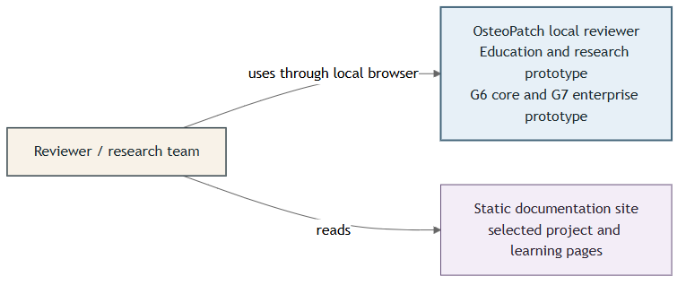
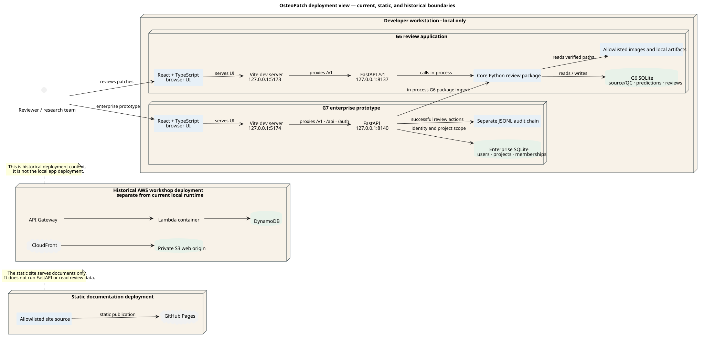
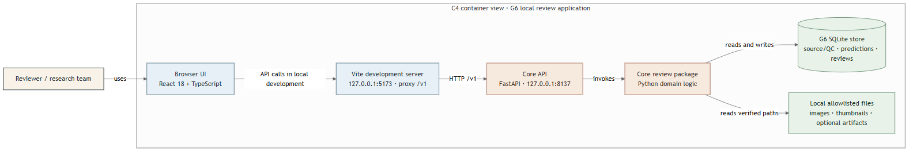
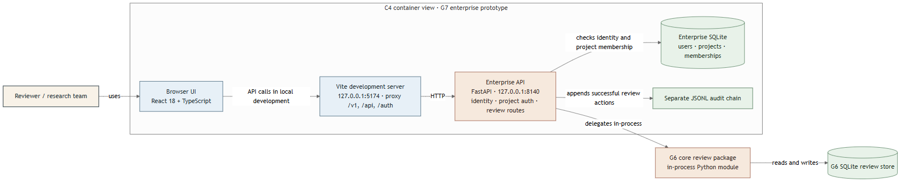
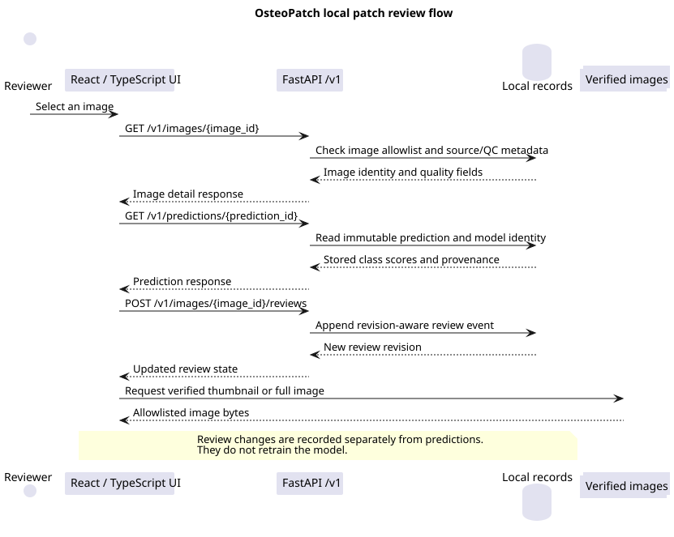
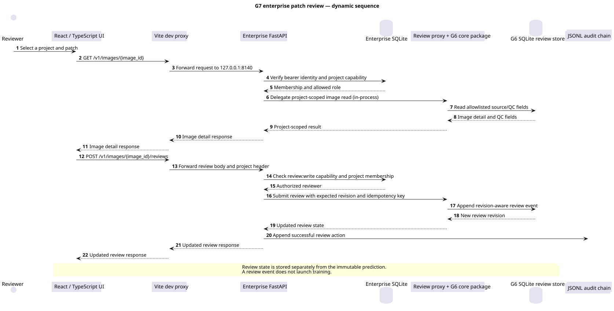
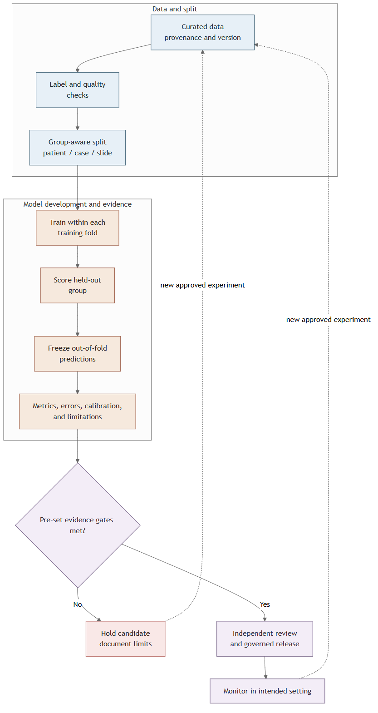
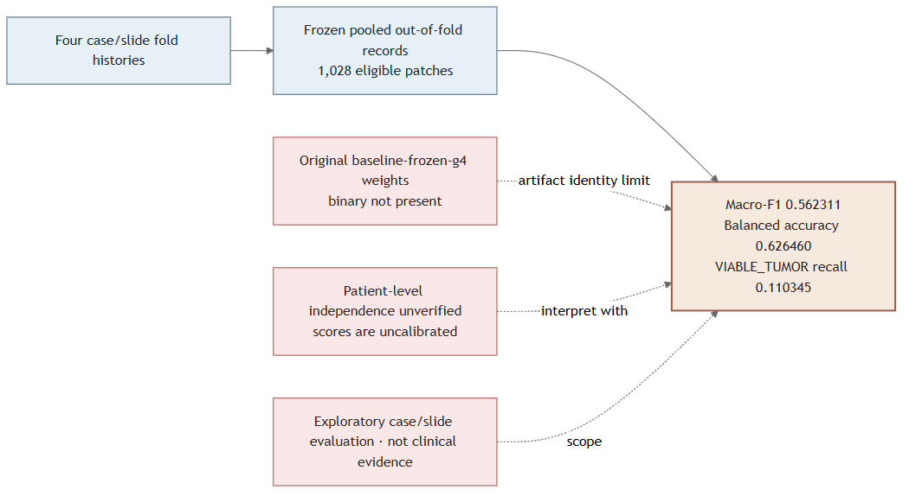
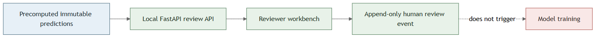
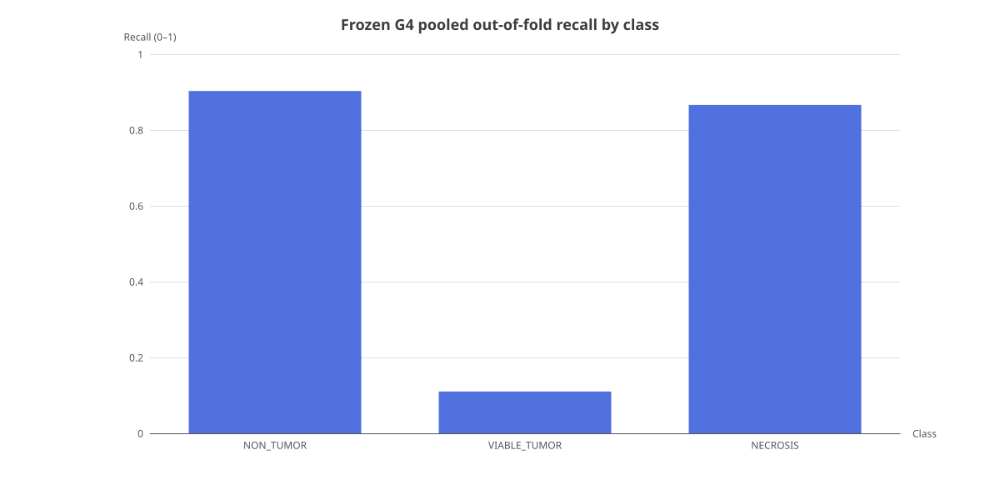

This gallery turns the installed diagram and presentation toolkit into concrete OsteoPatch examples. It separates checked project evidence from teaching diagrams and documents when a skill has code only or requires a connected service.

## A System context and deployment boundaries

Context diagrams name the people and systems around a product. The OsteoPatch docs site is a separate reading surface; it does not serve the review API. The [C4 model](https://c4model.com/diagrams) uses separate zoom levels so each view answers one architecture question.

This deployment view places each runtime inside its host boundary. G6 and G7 are local development applications. GitHub Pages is a static documentation deployment. The AWS resources are historical workshop context and do not represent the current local runtime.

## B Software stack and containers

G6 is the core local review application. Its browser UI calls FastAPI through the Vite `/v1` development proxy. The API invokes shared Python domain code, which reads the SQLite review store and allowlisted local files.

G7 adds its own UI, FastAPI boundary, user/project store, and audit file. It imports the G6 review package inside the process for project-scoped review operations. That path is Python code, not a second HTTP service call.

Editable sources: [G6 Mermaid](architecture.mmd), [G7 Mermaid](architecture-g7.mmd), and [Draw.io G6 view](architecture.drawio). [FigJam import text](figjam-import.mmd) and the local [Excalidraw element source](excalidraw-architecture-elements.json) show simpler collaborative sketches.

## C API sequence diagrams

A sequence diagram orders calls by time. The G7 view shows its project and role check, internal G6 delegation, revision-aware review write, and audit append. Edit these in [G6 PlantUML](api-review-sequence.puml) and [G7 PlantUML](enterprise-api-review-sequence.puml). A review does not change an immutable prediction or launch model training.

## D AI lifecycle: teaching model and project boundary

This is a teaching view of a governed ML lifecycle. ML systems usually include data checks, training, evaluation, release, and monitoring around the model code; see the [AWS ML lifecycle](https://docs.aws.amazon.com/wellarchitected/latest/machine-learning-lens/machine-learning-lifecycle.html) and [Google Cloud MLOps architecture](https://cloud.google.com/architecture/mlops-continuous-delivery-and-automation-pipelines-in-machine-learning). It does not claim that OsteoPatch trains from the UI.

The project diagrams distinguish the evidence record from the app’s stored prediction and human review paths. See the [editable lifecycle source](ai-training-lifecycle.mmd), [G4 provenance source](g4-evaluation-provenance.mmd), [application boundary source](application-review-training-boundary.mmd), [AntV infographic DSL](model-training.infographic), and [T8 evidence narrative](g4-evidence.t8.md).

An epoch is one pass over training examples. A fold holds out one group. An out-of-fold result predicts a group excluded from that fold’s training. Loss measures training fit. Held-out metrics measure separate evaluation. Calibration checks whether scores match observed frequencies.

## E Frozen G4 evidence chart

| Recorded measure | Value | Use |
|---|---:|---|
| Eligible examples scored | 1,028 | Four case or slide groups |
| Macro-F1 | 0.562311 | Mean F1 across configured classes |
| Balanced accuracy | 0.626460 | Mean of the three class recalls |
| NON_TUMOR recall | 0.902893 | Frozen exploratory evaluation |
| VIABLE_TUMOR recall | 0.110345 | The model missed many eligible examples |
| NECROSIS recall | 0.866142 | Frozen exploratory evaluation |

The page and diagram use tracked, frozen evidence from `overall-oof-metrics.json`. Source values are in [G2 declarative chart form](g2-g4-class-recall.json), [GPT-Vis chart form](gpt-vis-g4-class-recall.json), and the [unsubmitted AntV chart request](antv-chart-request-not-sent.json). I saved the AntV hosted request for review and did not send it.

These results are exploratory. Available records do not verify patient-level independence. One fold is single-class, some held-out class supports are small, the team has not calibrated the scores, and the original baseline weight file is absent. Do not use these numbers as clinical performance evidence.

## F What each skill and tool does here

| Skill or tool | OsteoPatch use | Example or state |
|---|---|---|
| Answer me with HTML | Build a one-file explainer with embedded diagrams and data images | This offline gallery and the main guide |
| Draw.io | Keep stack and container diagrams editable for design review | Local G6 `.drawio` file |
| Mermaid | Author C4-style context/container maps, request/data flows, and ML lifecycles as text | Editable sources and local PNGs |
| PlantUML | Show request order with UML sequence diagrams and runtime hosts with deployment diagrams | Editable `.puml` sources and local SVGs |
| Excalidraw MCP | Sketch a system map during a design discussion | Local app smoke test; JSON source preserved |
| ECharts | Render project metrics without adding an app dependency | Actual recall SVG, generated locally |
| AntV G2 | Describe metric charts in declarative JSON | Source included; package renderer is not installed |
| AntV G6 | Describe model-evidence relationships as a graph | Source included; graph package is not installed |
| AntV X6 | Prototype a patch review workflow as an interactive graph | Source included; graph package is not installed |
| AntV GPT-Vis | Provide compact JSON for a bar-chart view | Source included; no renderer invoked |
| AntV Infographic | Express a generic training lifecycle as a layout DSL | Source included; local renderer unavailable |
| AntV T8 | Build evidence narratives with semantic annotations | [Annotated report](g4-evidence.t8.md) and [React bridge](g4-evidence.t8.tsx); renderer is not installed |
| Chart Visualization skill | Recommend a chart type and prepare an AntV request | Request saved locally; hosted API not called |
| Data Visualization skill | Guide accessible, provenance-aware charts and summaries | Applied to this gallery and source guide |
| Dashboard skill | Build one-screen KPI and chart views | Installed; the skill requires a DESIGN.md, which this project lacks; this evidence gallery already provides the G4 summary |
| OpenSpec | Record scope and completion evidence for the documentation change | Change record in `openspec/changes/software-ai-visual-guide` |
| Netron | Inspect supported model graphs and tensor shapes | Installed; no OsteoPatch weight file is present |
| TensorBoard | Inspect recorded training logs and metrics | Installed; no event file is present |
| Marp, Slidev, and HTML-PPT skills | Turn technical material into teaching or stakeholder decks | Choose when a presentation artifact is useful |
| PPTX editor | Build a portable PowerPoint deck for review or training | [PowerPoint briefing](osteopatch-software-ai-brief.pptx) |
| Figma/FigJam and tldraw skills | Collaborate on design maps and diagrams | Account-connected; this gallery uploads no repository content |
| BioRender | Prepare scientific figures and schematic visuals | Hosted connector available; no project content sent; review account and license terms before use |
| Tableau MCP | Build data dashboards and reports | Environment lists an MCP-only connector flagged EOL-soon; not used here |
| Hugging Face TRL trainer | Plan or run SFT, DPO, and related language-model jobs | Cloud-job skill available; no job submitted and no project data uploaded |
| Hugging Face Datasets | Inspect dataset metadata or rows through Dataset Viewer | Remote read skill available; no dataset endpoint or row request made |
| Gradio | Prototype a separate interactive research demo | Skill available; this sample adds no app dependency or service |

## G Professional use and limits

Use a context view to show people and neighboring systems. Use container views to show the UI, API, database, and file boundaries. Use a sequence view to explain call order and a deployment view to show which host runs each part. Use a lifecycle flow and sourced metric chart for the model work.

| Work need | Best fit in this set | What to verify before sharing |
|---|---|---|
| Architecture and API review | C4 context/container maps, UML sequence, and editable Draw.io | Compare each box, route, and boundary with current code |
| Deployment and security review | UML deployment view | Confirm which resources are current, local, hosted, or historical |
| Team onboarding | This offline HTML guide and lifecycle diagrams | Keep teaching flows distinct from implemented runtime behavior |
| Research results | ECharts with frozen JSON provenance | Include split design, class support, uncertainty, and evidence date |
| Model internals | Netron | Use the matching model artifact and verify its identity |
| Training history | TensorBoard | Use real event logs; this repository has none |
| Product or enterprise review | PPTX or a locally rendered slide deck | Keep research claims and product readiness separate |
| Live co-design | Excalidraw, Figma/FigJam, or tldraw | Review sharing and retention controls before using cloud workspaces |

OpenSpec tracks proposed documentation work, implementation tasks, and validation. In plain terms, it gives a team a reviewable record of what is changing and what remains. It does not enforce architecture by itself.

[Open the main software and AI guide](../index.html). The project-facing guide and this gallery run without a server, external fonts, scripts, or API calls.
