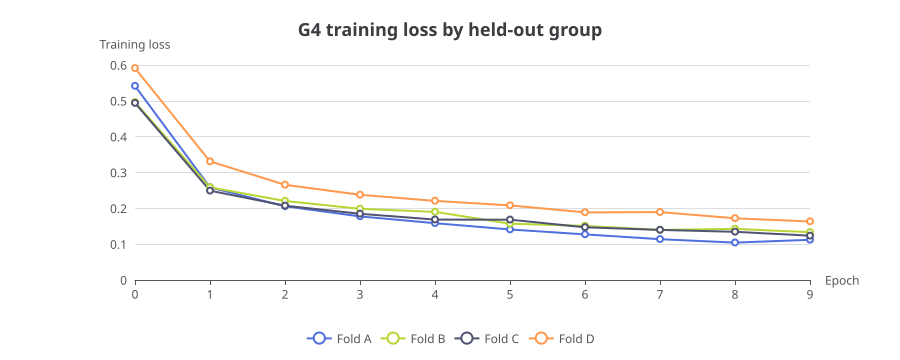

Lead: OsteoPatch is an educational and research prototype for human review of osteosarcoma image patches. This guide maps its software, API, development workflow, and documented model evidence.

## A Start with the system

The local reviewer uses a browser interface, a FastAPI service, and local records. The static website documents the project. It does not serve the review API.

```kv
Intended use: Education and research only
Browser app: React 18 and TypeScript
Local web server: Vite on 127.0.0.1:5173
Core API: FastAPI on 127.0.0.1:8137 with /v1 routes
Review store: SQLite
Model output: Precomputed immutable predictions
Image records: Source and quality-control metadata
Enterprise extension: Roles, projects, audit, registry, and worker services
Training runtime: Optional PyTorch dependencies in an isolated environment
```

An API is the agreed way that one program asks another program for data or an action. An endpoint is one address and method in that API.

## B Software architecture and deployment boundaries

```flow LR
Reviewer -> Browser: choose and inspect a patch
Browser -> Vite: local development server
Vite -> FastAPI: proxy requests under /v1
FastAPI -> [(SQLite)]: read and append review state
FastAPI -> [Predictions]: read immutable stored result
FastAPI -> [Source and QC]: read allowlisted metadata
FastAPI -> [Verified images]: read thumbnail or full image
Enterprise UI -> [Enterprise API]: identity, capabilities, and project scope
[Enterprise API] -> [(Enterprise SQLite)]: users, projects, memberships
[Enterprise API] -> [G6 core package]: in-process Python delegation
[G6 core package] -> [(SQLite)]: shared review data and predictions
[Enterprise API] -> [Audit JSONL]: append successful review actions
```

| Surface | What it serves | Boundary |
|---|---|---|
| Local reviewer | React app, API, review store, and local evidence | Development runtime |
| `site/` | Static documentation and project pages | No inference or reviewer data |
| Historical AWS demo | CloudFront, private S3, API Gateway, Lambda, and DynamoDB | Separate workshop deployment; status may lag the repository |

The Vite proxy is a development convenience. G6 listens on port 8137 and G7 on port 8140. G7 calls the G6 review package in-process, while keeping its own identity and project store. The [visualization gallery](showcase/index.html) has separate context, container, and deployment views.

## C The API review path

```sequence num
participants: Reviewer, React app, FastAPI, Local records
Reviewer -> React app: select an image
React app -> FastAPI: GET /v1/images/{image_id}
FastAPI -> Local records: check allowlist and read metadata
Local records --> FastAPI: image and QC fields
FastAPI --> React app: selected image details
React app -> FastAPI: GET /v1/predictions/{prediction_id}
FastAPI -> Local records: read immutable prediction
FastAPI --> React app: class scores and model identity
Reviewer -> React app: accept, correct, or defer
React app -> FastAPI: POST /v1/images/{image_id}/reviews
FastAPI -> Local records: append revision-aware review event
FastAPI --> React app: updated review state
```

| Method and endpoint | Purpose |
|---|---|
| `GET /v1/health`, `/v1/meta` | Service health and runtime metadata |
| `GET /v1/model-card` | Model identity and evidence summary |
| `GET /v1/images`, `/v1/images/{image_id}` | Allowlisted image records |
| `GET /v1/predictions/{prediction_id}` | Stored prediction record |
| `GET /v1/images/{image_id}/thumbnail`, `/full` | Protected image derivatives |
| `GET /v1/images/{image_id}/review`, `POST .../reviews` | Read review state and append a review event |
| `GET /v1/images/{image_id}/attribution`, `/attribution/meta` | Qualified attribution and its metadata |
| `GET /v1/exports/reviews` | Export review records |

When the local FastAPI app runs, its default API references are at `/docs`, `/redoc`, and `/openapi.json`. This guide documents routes; it adds no endpoint.

An HTTP method describes the action: `GET` reads, and `POST` submits a new action or record. A proxy forwards a request to another service. SQLite is a local relational database.

## D Development terms and change workflow

```timeline
Need | Describe | State the problem and the result people need
Explore | Inspect | Read the code, evidence, and constraints
Propose | Plan | Record why, behavior, design, and tasks in OpenSpec
Apply | Build | Make the scoped change and update its task list
Verify | Check | Run the stated checks and inspect the result
Archive | Record | Move the completed change into the lasting spec history
```

| Term | Plain meaning | Software meaning |
|---|---|---|
| Repository | A project's tracked files | Git history, branches, and current working tree |
| Branch | A separate line of work | A named reference to a sequence of Git commits |
| Pull request | A proposed code change | Review and merge interface for a branch |
| Build | Prepare software to run | Compile, bundle, or package source files |
| Test | Check expected behavior | Automated assertion over code or a user flow |
| CI | Automatic checks after a change | Continuous integration jobs such as lint, tests, and builds |
| Release | A named deliverable | Versioned package or deployment candidate |
| Deploy | Put a build in an environment | Install or publish a chosen artifact to a target system |
| OpenSpec | A structured change record | Proposal, requirements, design, tasks, and archive workflow |

OpenSpec is change management. It helps teams plan and track implementation. Answer me with HTML turns a Markdown draft into a single offline explainer page. They complement the diagram tools.

## E AI and model training, from data to review

```flow LR
[Source data and provenance] -> [Quality checks]
[Quality checks] -> [Group-aware split]
[Group-aware split] -> [Train model]
[Train model] -> [Held-out fold predictions]
[Held-out fold predictions] -> [Metrics and error review]
[Metrics and error review] -> [Model card and limitations]
[Model card and limitations] -> [Application review]
[Application review] -> [Append-only human event]
[Append-only human event] --> [New approved experiment]
```

The upper stages describe a general machine-learning workflow. The app currently reads precomputed predictions. The app stores a reviewer correction as an event; it does not retrain a model automatically.

| Term | Meaning |
|---|---|
| Epoch | One pass over the training examples used by a run |
| Fold | One group-based split used to train and evaluate a model |
| Out-of-fold prediction | A prediction from a fold whose training set excluded that held-out group |
| Recall | The share of true examples of a class that the model found |
| Calibration | Whether scores match observed probabilities; the model reports uncalibrated class scores |
| Model weights | Learned numeric parameters saved in a model file |
| Confusion matrix | Counts of true classes against predicted classes |
| Grad-CAM | A visualization of model behavior; not a segmentation or causal explanation |

Training loss describes fit to the training data. It does not show held-out performance. Read it with held-out metrics and the split design.

## F Recorded G4 evidence and limits



| Frozen pooled out-of-fold measure | Value | What it says |
|---|---:|---|
| Macro-F1 | 0.562311 | Mean F1 across the three configured classes |
| Balanced accuracy | 0.626460 | Mean recall across the three configured classes |
| Secondary accuracy | 0.670233 | Overall correct fraction; secondary summary only |
| `VIABLE_TUMOR` recall | **0.110345** | The model missed most eligible viable-tumor patches in this evaluation |

The run scored each of 1,028 eligible patches once across four case or slide groups. The full locally verified source collection has 1,144 patches. The historical public demo uses a separate 50-image subset.

| Class | Recall | F1 | Support |
|---|---:|---:|---:|
| `NON_TUMOR` | 0.902893 | 0.842004 | 484 |
| `VIABLE_TUMOR` | 0.110345 | 0.179272 | 290 |
| `NECROSIS` | 0.866142 | 0.665658 | 254 |

These are exploratory case or slide-group results. We lack evidence for patient-level independence. One fold is single-class, and two held-out class supports are very small. Scores are not calibrated disease probabilities. They do not establish prospective or clinical performance.

The original `baseline-frozen-g4` model binary is absent. The recovered attribution head has a different identity and cannot inherit the original model's evaluation. The app is for education and research, not diagnosis or treatment decisions.

Sources: [architecture](../architecture.md), [API contracts](../08_data_and_api_contracts.md), [model evidence](../model-evidence.md), [frozen G4 metrics](../../aidlc-docs/inception/model/g4/overall-oof-metrics.json), and [G4 fold histories](../../aidlc-docs/inception/model/g4/fold-histories.json).

## G Local tools, skills, and MCP servers

| Tool or collection | Best use | Installed state, license, and source | Limits |
|---|---|---|---|
| OpenSpec CLI | Plan, validate, and track code changes | Installed 1.14.1; MIT; [OpenSpec](https://github.com/Fission-AI/OpenSpec) | Workflow tool; it does not draw diagrams |
| Answer me with HTML | Render an explainer from Markdown | Installed from upstream; no release version declared in `SKILL.md`; MIT; [skill](https://github.com/QingYunA/answer-me-with-html) | Generates the page; the authoring draft stays in this folder |
| Excalidraw MCP App | Interactive hand-drawn diagrams | Local stdio server 0.3.2; MIT; [source](https://github.com/excalidraw/excalidraw-mcp) | Export to excalidraw.com is an explicit external action |
| Netron | Inspect supported neural-network model files | Installed 9.3.1; MIT; [Netron](https://github.com/lutzroeder/netron) | No model-weight file is present in this repository |
| TensorBoard | View logged metrics, graphs, and distributions | Installed 2.21.0; Apache-2.0; [TensorBoard](https://github.com/tensorflow/tensorboard) | No event log is present; current results come from tracked JSON and CSV |
| Draw.io MCP | Edit local `.drawio` pages and open diagrams for review | Local page editing works; Apache-2.0; [server](https://github.com/jgraph/drawio-mcp) | The open action loads app.diagrams.net with XML in the URL fragment. Use it only for non-sensitive diagrams. Keep private content in local `.drawio` files and renders. Draw.io Desktop is absent, so desktop export is unavailable |
| Mermaid renderer | Render Mermaid diagrams as PNG | Installed and tool-tested; MIT; [server](https://github.com/Volare-Consulting-Software/mermaid-mcp) | Static render; source diagram remains the editable form |
| PlantUML renderer | Validate UML and render SVG | Installed and tool-tested; MCP MIT, PlantUML core LGPL-3.0; [project](https://github.com/plantuml/plantuml) | Check the core LGPL terms before redistribution |
| ECharts MCP | Render chart families locally | Installed and tested; MIT; [server](https://github.com/hustcc/mcp-echarts) | Downloads its package at first launch |
| AntV chart MCP | Build common business and data charts | Installed and tested; MIT; [server](https://github.com/antvis/mcp-server-chart) | Returned image uses an external endpoint; do not send private data |
| PPTX editor | Create and inspect editable PowerPoint decks | Installed and tested; MIT; [server](https://github.com/knorq-ai/pptx-mcp-server) | Built a local 5-slide deck; layout check passed; PNG preview needs LibreOffice, which is absent |
| Marp MCP | Author and export Markdown slide decks | Installed and tested; MIT; [server](https://github.com/masaki39/marp-mcp) | Deck workflow rather than an interactive software map |
| Slidev CLI and skills | Create web-based developer presentations | Installed; MIT; [Slidev](https://github.com/slidevjs/slidev) and [skills](https://github.com/yoanbernabeu/slidev-skills) | Produces a presentation, not an API reference |
| PPTXGenJS MCP | Build slides with native shapes and charts | Installed and tool-tested; upstream source does not state a license; [source](https://github.com/Hrithik-s-Raj/PptxGenJS-mcp-server) | Avoid redistribution until its maintainers clarify the license |
| Python PowerPoint MCP | Edit presentations through python-pptx | Installed in an isolated legacy environment; MIT; [source](https://github.com/juanocampo400/powerpoint-mcp) | Not tool-tested; requires `python-pptx <0.7` |
| Presentation skill | Plan and build professional decks | Installed; MIT; [source](https://github.com/siril9/presentation-skill) | Skill files found; representative skill call not tested |
| HTML PPT skill | Build slide-like HTML presentations | Installed; MIT; [source](https://github.com/lewislulu/html-ppt-skill) | Skill files found; representative skill call not tested |
| HTML slides skill | Build custom HTML slides | Installed; MIT; [source](https://github.com/robbertvanempel/slides) | Skill invocation not tested |
| AntV chart skills | Choose and author charts with AntV | Nine skills installed; MIT; [source](https://github.com/antvis/chart-visualization-skills) | Local G2/G6/X6/GPT-Vis examples are source-only because their packages are absent; hosted API was not called |
| Hugging Face skills | Work with model jobs, datasets, and Gradio demos | Curated skills available in the local Codex plugin cache | Training jobs and dataset API access can send or retrieve data; we did not submit any jobs, make row requests, or upload data |
| OpenDesign presentation skills | Prepare branded slide formats | Sixteen skills installed; Apache-2.0; [source](https://github.com/vustudio/opendesign) | Presentation-focused skill collection |
| OpenAI Figma skills | Design files, systems, and diagrams | Five skills available; licenses vary by skill; [skills](https://github.com/openai/skills) | Use an account-connected Figma document only with its own sharing controls |

## H Available integrations and excluded alternatives

Figma and FigJam, tldraw, Canva, Google Slides, MagicPath, Inwjud, and BioRender are available as managed Codex integrations. Their account, sharing, and data-handling rules depend on the connected service. The workspace lists Tableau as an MCP-only connector and flags it EOL-soon. This offline guide does not send repository content to these services.

| Alternative | Status and reason |
|---|---|
| PPT-MCP | Not installed; Apache-2.0; overlaps the tested PPTX editor |
| Archived Office PowerPoint MCP | Present in the local toolkit audit, but archived and fails startup because its published wheel omits a module |
| Vega MCP package | Unavailable under the advertised npm package name; install returned 404 |
| cmd8 Excalidraw MCP | Not installed; prior clone failed; the tested local Excalidraw server covers interactive diagrams |
| Structurizr CLI | Not installed; its CLI is legacy; existing Mermaid and PlantUML cover diagrams as code |
| MLflow and Weights & Biases | Not configured; these add experiment tracking and possible remote storage beyond this guide |

The guide sends no repository images, database rows, credentials, or model weights. Follow each upstream license before redistributing its software or generated assets.


[Open the local visualization gallery](showcase/index.html) for C4 context and container views, UML deployment and API sequence diagrams, the AI lifecycle, and frozen G4 evidence. Each view includes editable sources.
